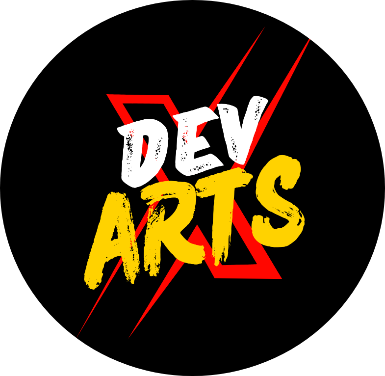

<!DOCTYPE html>
<html lang="hi">
<head>
    <meta charset="UTF-8">
    <meta name="viewport" content="width=device-width, initial-scale=1.0, maximum-scale=1.0, user-scalable=no">
    <title>Devartsx - 3D Ultra Graphics Studio</title>
    <!-- Google Fonts -->
    <link href="https://fonts.googleapis.com/css2?family=Orbitron:wght@600;800;900&family=Poppins:wght@300;400;600;700;800&display=swap" rel="stylesheet">
    <!-- Font Awesome Icons -->
    <link rel="stylesheet" href="https://cdnjs.cloudflare.com/ajax/libs/font-awesome/6.4.0/css/all.min.css">
    
    
</head>
<body>

    

    

    <!-- Navbar -->
    <nav>
        <a href="#home" class="logo-box">
            
            Devartsx
        </a>
        <ul class="nav-links">
            <li><a href="#home">होम</a></li>
            <li><a href="#portfolio">पोर्टफोलियो</a></li>
            <li><a href="#pricing">प्राइस</a></li>
            <li><a href="#order">ऑर्डर इनबॉक्स</a></li>
        </ul>
    </nav>

    <!-- Hero Section -->
    <section class="hero" id="home">
        
🎨 3D Ultra Graphics Sketch Studio

        <h1>Devartsx Studio</h1>
        
चारकोल एवं ग्रेफाइट पेंसिल स्केच मेकिंग। प्रीमियम और हाई-ग्राफिक रियलिस्टिक स्केच जो आपकी यादों को हमेशा के लिए जीवंत बना दें!

        
        

            <a href="#portfolio" class="btn-3d"><i class="fas fa-layer-group"></i> पोर्टफोलियो देखें</a>
            <a href="#order" class="btn-3d btn-outline-3d"><i class="fab fa-whatsapp"></i> आर्डर भेजें</a>
        

    </section>

    <!-- Portfolio 3D Section -->
    <section class="portfolio-section" id="portfolio">
        

            <h2>मेरा पोर्टफोलियो</h2>
            

        

        

            

                

                    
                

                

                    <h3>शिव जी और पार्वती जी स्केच</h3>
                    चारकोल व ग्रेफाइट 
                    <a href="#order" class="btn-3d" style="padding: 8px 20px; font-size: 0.85rem;">आर्डर करें</a>
                

            

            

                

                    
                

                

                    <h3>एनिमे स्केच</h3>
                    एनिमे आर्ट 
                    <a href="#order" class="btn-3d" style="padding: 8px 20px; font-size: 0.85rem;">आर्डर करें</a>
                

            

            

                

                    
                

                

                    <h3>रियलिस्टिक आई स्केच</h3>
                    अल्ट्रा रियलिस्टिक 
                    <a href="#order" class="btn-3d" style="padding: 8px 20px; font-size: 0.85rem;">आर्डर करें</a>
                

            

            

                

                    
                

                

                    <h3>जो जो सातो स्केच</h3>
                    गोझो सातोरू स्केच 
                    <a href="#order" class="btn-3d" style="padding: 8px 20px; font-size: 0.85rem;">आर्डर करें</a>
                

            

            

                

                    
                

                

                    <h3>गणपति जी स्केच</h3>
                    चारकोल व ग्रेफाइट 
                    <a href="#order" class="btn-3d" style="padding: 8px 20px; font-size: 0.85rem;">आर्डर करें</a>
                

            

        

    </section>

    <!-- Pricing Section -->
    <section class="pricing-section" id="pricing">
        

            <h2>प्राइस रेट कार्ड</h2>
            

        

        

            

                
A4 Size

                
₹599 only

                <ul class="price-list">
                    <li><i class="fas fa-check-circle"></i> चारकोल & ग्रेफाइट स्केच</li>
                    <li><i class="fas fa-check-circle"></i> 100% हैंडमेड आर्टवर्क</li>
                    <li><i class="fas fa-check-circle"></i> सिंगल / कपल्स पोर्ट्रेट</li>
                    <li><i class="fas fa-check-circle"></i> सेफ पैकेजिंग & डिलीवरी</li>
                </ul>
                <a href="#order" class="btn-3d" onclick="selectSize('A4 Size (₹599)')">यह साइज़ चुनें</a>
            

            

                
★ बेस्ट सेलिंग ★

                
A3 Size

                
₹999 only

                <ul class="price-list">
                    <li><i class="fas fa-check-circle"></i> लार्ज A3 साइज़ (डबल A4)</li>
                    <li><i class="fas fa-check-circle"></i> प्रीमियम चारकोल शैडिंग</li>
                    <li><i class="fas fa-check-circle"></i> अल्ट्रा रियलिस्टिक डिटेलिंग</li>
                    <li><i class="fas fa-check-circle"></i> स्प्रे फिक्सेटिव प्रोटेक्टेड</li>
                    <li><i class="fas fa-check-circle"></i> सेफ पैकेजिंग & डिलीवरी</li>
                </ul>
                <a href="#order" class="btn-3d" onclick="selectSize('A3 Size (₹999)')">यह साइज़ चुनें</a>
            

        

    </section>

    <!-- WhatsApp Order Inbox Section -->
    <section class="order-section" id="order">
        

            <h2>डायरेक्ट व्हाट्सएप इनबॉक्स</h2>
            

        

        

            <form id="orderForm" onsubmit="sendWhatsAppOrder(event)">
                

                    <label for="name"><i class="fas fa-user-circle"></i> आपका नाम</label>
                    <input type="text" id="name" class="form-input" placeholder="अपना नाम लिखें" required>
                

                

                    <label for="phone"><i class="fas fa-phone"></i> मोबाइल नंबर</label>
                    <input type="tel" id="phone" class="form-input" placeholder="फ़ोन नंबर दर्ज करें" required>
                

                

                    <label for="size"><i class="fas fa-ruler-combined"></i> स्केच साइज़ चुनें</label>
                    <select id="size" class="form-input" required>
                        <option value="A4 Size - ₹599">A4 Size (₹599)</option>
                        <option value="A3 Size - ₹999">A3 Size (₹999)</option>
                    </select>
                

                

                    <label for="sketchType"><i class="fas fa-palette"></i> स्केच का नाम / फोटो विवरण</label>
                    <input type="text" id="sketchType" class="form-input" placeholder="उदा. शिव पार्वती स्केच या अपनी फोटो" required>
                

                

                    <label for="details"><i class="fas fa-comment-dots"></i> अतिरिक्त जानकारी</label>
                    <textarea id="details" class="form-input" placeholder="यदि कोई खास सवाल या मैसेज हो तो यहाँ लिखें..."></textarea>
                

                <button type="submit" class="btn-3d" style="width: 100%; justify-content: center; font-size: 1.1rem;">
                    <i class="fab fa-whatsapp"></i> व्हाट्सएप पर मैसेज भेजें
                </button>
            </form>
        

    </section>

    <footer>
        
© 2026 Devartsx Studio | व्हाट्सएप ऑर्डर: +91 7827417956

    </footer>

    <!-- Interactive 3D JavaScript Animations -->
    
</body>
</html>
